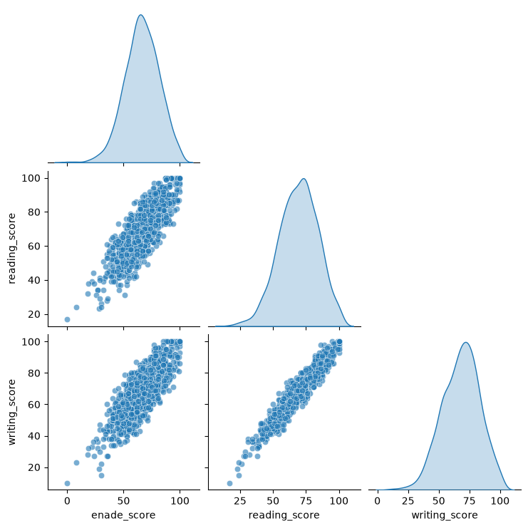

# Student Score Prediction

<p align="center">
  
</p>

<p align="center">
  <em>Pairplot illustrating the relationships between numerical variables in the dataset.</em>
</p>

## Overview

This project explores the application of **Linear Regression** to predict student academic performance based on demographic characteristics and examination scores.

The workflow covers exploratory data analysis, data preprocessing, regression modeling, model evaluation, and the development of a REST API using FastAPI to serve predictions locally.

## Project Background

The project idea originated from a practical exercise developed during an Alura course on Linear Regression.

The original exercise, available in the [Alura course repository](https://github.com/alura-cursos/regressao-linear-alura), proposes predicting student performance using a dataset adapted to simulate an educational context based on the Brazilian ENADE examination.

Building upon this initial proposal, I developed my own implementation, expanding the workflow to include a more detailed exploratory data analysis, statistical investigation of the variables, comparison of regression models, and deployment of the selected model through a REST API.

## Dataset

The project uses the **StudentsPerformance** dataset, originally available on [Kaggle](https://www.kaggle.com/datasets/spscientist/students-performance-in-exams).

The dataset was adapted in the original project to simulate an academic performance score in the context of the Brazilian ENADE examination.

The target variable, `enade_score`, is therefore a simulated score created for this modeling exercise. It does not represent actual ENADE examination results.

After data preparation, the dataset contains **999 observations and 8 variables**:

| Variable | Description | Type |
|---|---|---|
| `sex` | Student's sex | Categorical |
| `race/ethnicity` | Student's race/ethnicity group | Categorical |
| `parental_level_of_education` | Parent's level of education | Categorical |
| `lunch` | Type of lunch program | Categorical |
| `test_preparation_course` | Test preparation course status | Categorical |
| `reading_score` | Reading assessment score | Numerical |
| `writing_score` | Writing assessment score | Numerical |
| `enade_score` | Simulated final academic score | Numerical (target) |

One observation with a target value of zero was removed during data preparation, resulting in 999 observations for the modeling stage.

## Methodology

The project is organized into two main notebooks.

### 1. Exploratory Data Analysis

The first notebook (`01-EDA.ipynb`) focuses on understanding the dataset and investigating relationships between its variables.

The analysis includes:

- Data structure and descriptive statistics.
- Distribution analysis of numerical variables.
- Identification and assessment of potential outliers.
- Investigation of relationships between numerical and categorical variables.
- Correlation analysis.

The exploratory analysis supports the understanding of the dataset and informs the subsequent modeling decisions.

### 2. Regression Modeling

The second notebook (`02-regression.ipynb`) covers data preprocessing, model training, comparison, and evaluation.

**Data preprocessing**

The dataset was divided into training and testing subsets using an 80/20 split, with `random_state=42`.

A preprocessing pipeline was developed using:

- `StandardScaler` for numerical features.
- `OneHotEncoder` for categorical features.
- `ColumnTransformer` to combine both transformations.

**Models evaluated**

Three regression algorithms were compared:

- Ordinary Least Squares Linear Regression.
- Ridge Regression.
- Lasso Regression.

**Evaluation metrics**

Model performance was assessed using:

- **R²:** coefficient of determination.
- **MAE:** Mean Absolute Error.
- **RMSE:** Root Mean Squared Error.

## Results

The three models achieved very similar performance on the test set.

| Model | R² | MAE | RMSE |
|---|---:|---:|---:|
| Linear Regression | 0.8895 | 3.92 | 4.93 |
| Ridge Regression | 0.8894 | 3.93 | 4.93 |
| Lasso Regression | 0.8896 | 3.93 | 4.93 |

Ordinary Least Squares Linear Regression was selected as the final model due to its simplicity and practically equivalent predictive performance compared with the regularized alternatives.

The selected model and its corresponding preprocessing pipeline were serialized and saved for subsequent use by the API.

## REST API

A REST API was developed using **FastAPI** to make predictions with the trained model.

The API receives student information as a JSON request, applies the previously saved preprocessing pipeline, and returns the predicted `enade_score`.

The implementation is divided into the following components:

- `main.py`: defines the FastAPI application and prediction endpoint.
- `api_model.py`: loads the saved model and preprocessor and performs predictions.
- `config.py`: defines the paths to the serialized model artifacts.

### Running the API locally

After installing the project dependencies, execute the following command from the repository root:

```bash
python -m uvicorn notebooks.src.main:app --reload
```

While the server is running, the API can be accessed locally at:

- **API root:** `http://127.0.0.1:8000`
- **Swagger UI:** `http://127.0.0.1:8000/docs`
- **ReDoc:** `http://127.0.0.1:8000/redoc`

The interactive Swagger documentation allows users to submit prediction requests through the `POST /predict` endpoint.

**Note:** The API is not hosted online. These addresses are only accessible on the local machine where the server is running.

### Example request

```json
{
  "sex": "female",
  "race/ethnicity": "group B",
  "parental_level_of_education": "bachelor's degree",
  "lunch": "standard",
  "test_preparation_course": "completed",
  "reading_score": 85,
  "writing_score": 88
}
```

Example response:

```json
{
  "message": "Prediction successful!",
  "predicted_enade_score": 75.77
}
```

## Project Structure

```text
01_regressao/
│
├── data/
│
├── images/
│   └── pairplot.png
│
├── models/
│   ├── linear_regression_model.pkl
│   └── preprocessor.pkl
│
├── notebooks/
│   ├── 01-EDA.ipynb
│   ├── 02-regression.ipynb
│   │
│   └── src/
│       ├── __init__.py
│       ├── api_model.py
│       ├── auxiliary.py
│       ├── config.py
│       ├── main.py
│       └── model.py
│
├── .gitignore
└── requirements.txt
```

## Installation and Usage

Clone the repository:

```bash
git clone https://github.com/Paiarinho/linear-regression-student-performance.git
cd linear-regression-student-performance
```

Create and activate a virtual environment:

```bash
python -m venv .venv
source .venv/bin/activate
```

Install the required dependencies:

```bash
pip install -r requirements.txt
```

Open the notebooks in Jupyter or VS Code to explore the analysis and modeling workflow.

To start the API, follow the instructions in the [REST API](#rest-api) section.

## Limitations

- The target variable is simulated and does not represent actual ENADE examination scores.
- The dataset contains a limited number of observations and may not represent the diversity of real-world student populations.
- Model evaluation was conducted using a holdout test set from the same dataset. Performance on independent datasets has not been assessed.
- Predictions should be interpreted within the context and limitations of the dataset used to develop the model.

## Acknowledgements

- [Alura](https://github.com/alura-cursos/regressao-linear-alura) — Original project idea and practical exercise.
- [Kaggle — StudentsPerformance Dataset](https://www.kaggle.com/datasets/spscientist/students-performance-in-exams) — Original dataset.
